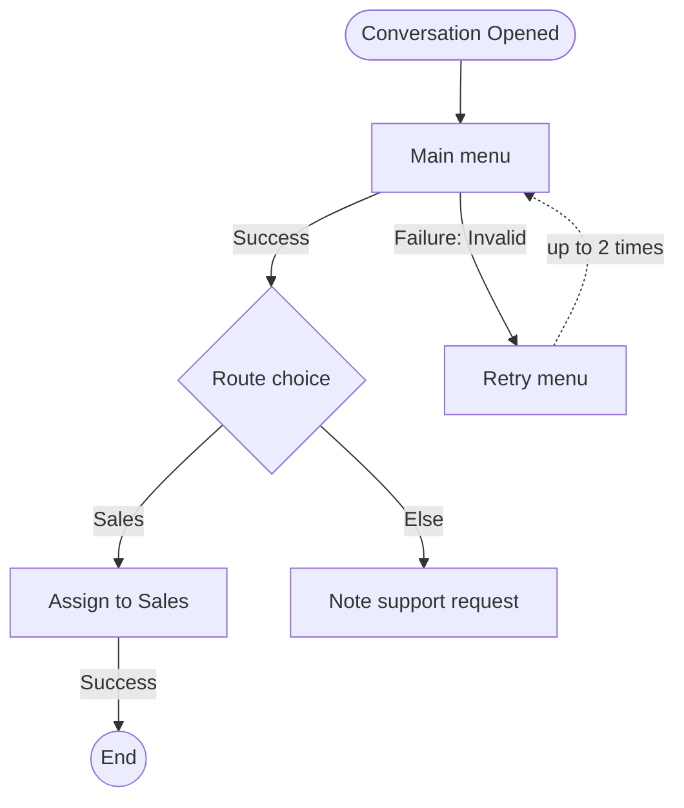

# Visualizing a workflow

Draw from `payload` of a fresh `get_workflow` result (or the `trigger`, `triggerPayload` and `steps` of `get_workflow_template`), never from the payload you sent: the server adds default connectors and step names when it saves.

## Reading the step list

`steps` is flat. Each step points at its parent with `parentId`; `parentId: 1` is the step right after the trigger.

- **Regular steps** (`sendMessage`, `askQuestion`, `assignTo`, `branch`, `wait`, …) are boxes. Label them with their `name`, which is unique within the workflow.
- **Connector steps** — any `data.type` ending in `Connector` (`askQuestionConnector`, `branchConnector`, `dateTimeConnector`, …) — are **not boxes**. Each one is an outcome of its parent: draw it as a labelled edge from the parent to the connector's own child. The label is the connector's `name` (`Success`, `Failure: Invalid`, `Failure: Timeout`, a branch name, `Else`).
- A connector with no child ends the run on that outcome: draw its edge to an end node.
- **Branch order** is the order of the parent's `data.connectors`, which is the order the conditions are checked. Draw them in that order. The connector with `conditions: null` is Else.
- **`jumpTo`** is a box whose run continues at `data.stepId`, which is not its child. Draw a dashed edge back to that step, labelled with how many times it can jump (`data.maxJumps`).

## Mermaid recipe

- Start with `flowchart TD`.
- Node ids: `s_` plus the step id with anything other than letters, digits and `_` replaced by `_`. Never use a bare `end` as an id.
- Trigger: a rounded node, `trigger(["Conversation Opened"])`, labelled with the trigger in words.
- Regular step: `s_id["Name"]`; a `branch` step as a diamond, `s_id{"Name"}`. Put labels in double quotes, and swap any `"` inside for `'`.
- Regular parent to regular child: `s_parent --> s_child`.
- Connector: `s_owner -->|"Connector name"| s_child`, or `s_owner -->|"Connector name"| end_N(("End"))` when it has no child (a new `end_N` id each time).
- `jumpTo`: `s_jump -.->|"up to N times"| s_target`.
- Optionally add the step type under the name, `s_id["Name<br/>Ask a Question"]`, when names don't make it obvious.

If the client doesn't render Mermaid, use the text tree below instead: one line per box, indented under its parent, with the connector name before the arrow.

## Worked example

`payload` of a menu workflow, as `get_workflow` returns it:

```json
{
  "trigger": "conversationOpened",
  "triggerPayload": {
    "oncePerContact": false,
    "conditions": { "$and": [{ "category": "", "field": "", "operator": "", "value": "" }] }
  },
  "steps": [
    {
      "id": "ask",
      "parentId": 1,
      "type": "step",
      "name": "Main menu",
      "data": {
        "type": "askQuestion",
        "question": { "text": "How can we help?", "type": "multiple", "options": ["Sales", "Support"] },
        "saveResponse": { "field": null, "variable": "menu_choice", "tag": false },
        "timeout": { "value": 7, "unit": "days" },
        "connectors": ["ask-ok", "ask-invalid"]
      }
    },
    {
      "id": "ask-ok",
      "parentId": "ask",
      "type": "step",
      "name": "Success",
      "data": { "type": "askQuestionConnector", "connectorType": "success" }
    },
    {
      "id": "ask-invalid",
      "parentId": "ask",
      "type": "step",
      "name": "Failure: Invalid",
      "data": { "type": "askQuestionConnector", "connectorType": "failure" }
    },
    {
      "id": "route",
      "parentId": "ask-ok",
      "type": "step",
      "name": "Route choice",
      "data": { "type": "branch", "connectors": ["route-sales", "route-else"] }
    },
    {
      "id": "route-sales",
      "parentId": "route",
      "type": "step",
      "name": "Sales",
      "data": {
        "type": "branchConnector",
        "conditions": {
          "$and": [{ "category": "variable", "field": "menu_choice", "operator": "isEqualTo", "value": "Sales" }]
        }
      }
    },
    {
      "id": "route-else",
      "parentId": "route",
      "type": "step",
      "name": "Else",
      "data": { "type": "branchConnector", "conditions": null }
    },
    {
      "id": "assign-sales",
      "parentId": "route-sales",
      "type": "step",
      "name": "Assign to Sales",
      "data": {
        "type": "assignTo",
        "assignTo": "teamUser",
        "teamId": 7,
        "assignmentLogic": "RoundRobin",
        "connectors": ["assign-sales-ok"]
      }
    },
    {
      "id": "assign-sales-ok",
      "parentId": "assign-sales",
      "type": "step",
      "name": "Success",
      "data": { "type": "assignToConnector", "connectorType": "success" }
    },
    {
      "id": "support-note",
      "parentId": "route-else",
      "type": "step",
      "name": "Note support request",
      "data": { "type": "addComment", "comment": "Contact asked for support from the menu." }
    },
    {
      "id": "retry",
      "parentId": "ask-invalid",
      "type": "step",
      "name": "Retry menu",
      "data": { "type": "jumpTo", "stepId": "ask", "maxJumps": 2 }
    }
  ]
}
```

Diagram:



Text tree:

```text
Conversation Opened
└─ Main menu (Ask a Question)
   ├─ Success → Route choice (Branch)
   │  ├─ Sales → Assign to Sales (Assign To)
   │  │  └─ Success → end
   │  └─ Else → Note support request (Add Comment)
   └─ Failure: Invalid → Retry menu (Jump to "Main menu", up to 2 times)
```

Five connector records became five labelled edges, and the jump appears as a loop even though it is not anyone's child.
